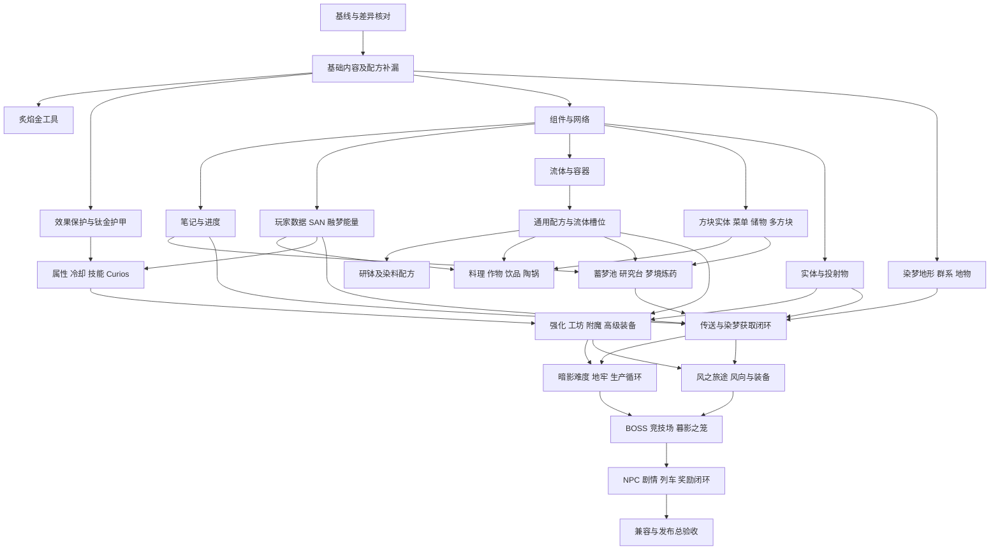

# NeoForge 迁移任务线

> 制订日期：2026-10-29。本文安排后续迁移顺序，不代表对应内容已经完成。
> 实际完成与验证结果以 [迁移批次记录](./迁移批次记录.md) 为准；平台差异参考 [移植总纲](./移植总纲.md)，执行规则见 [程序规范文档](../rule/program/程序规范文档.md)。

## 1. 基线与使用方式

- 本次规划读取 Forge 已合并的本地 `origin/master` 对象：`abe0ab9cc1d2ba858ef96693c8b745ddbff2b34f`（PR #1247）。使用 `git show <SHA>:<path>` / `git grep <SHA>`，没有把来源个人分支工作树当作正式源码。
- 来源 checkout 为 `679f66c3172461bcf7ffb390a0dfba1c57c20b49`，比上述本地引用多 2 个提交、12 个文件存在差异；读取前没有默认采用它。随后远程 compare 确认该提交已随 #1248 合并。另有未跟踪 `document/tutorial/`，未纳入规划。来源仓库只读，未 fetch 或修改它。
- 初始沙箱请求受限；随后在允许联网的执行环境中完成 GitHub API 检查。首次成功及结束复核的正式 `master` 均为 `7819bc6c769ead7656f655878641fa8c20ab011f`（PR #1249），开放 PR 均为 0。相对本地规划快照新增 #1248/#1249，已定向审阅影响并纳入 T17/T19/T20；实际迁移按 T00 再锁定当批最新已合并来源。
- 全局已审阅游标仍是 `76447a387853931d016743232b390e2853ca4138`。本次只做规划所需的定向源码核对，不宣布 #1219–#1247 已全部审阅。
- 目标规划起点为 `b3c680a`：批次 001–005 及中文名称修正。现有功能保持，后续任务不要求重新搬运已经验证的内容。

新增上游依据：[正式分支增量对比](https://github.com/PasterDreamReborn-Organization/PasterDream-Reborn-forge1.20.1/compare/abe0ab9cc1d2ba858ef96693c8b745ddbff2b34f...7819bc6c769ead7656f655878641fa8c20ab011f)。#1248 简化通用跨维度传送并保留效果补发；竞技场类的实际 diff 仍含自身 3 tick 落点同步，不能依据提交摘要一律删除。#1249 调整裂隙首次接触、进度门禁、声音/冷却与传送分支的执行顺序，T17 必须以合并后的类为来源。

任务编号 `Txx` 是稳定的依赖索引，与“批次 006”等实际提交批次编号不同。一个任务可以分多批完成，但必须保留未完成子项。表中的前置是进入该子任务的最低门槛；实际落地前还需查所选类的直接引用、事件、Mixin、数据和资源引用。不要把整个大系统完成当成所有独立内容的前置。

每项内容分别登记以下状态，不能用单个“已完成”代替：

| 维度 | 状态示例 | 判定依据 |
|---|---|---|
| 注册与资源 | 未迁 / 已注册 / 资源齐全 | 注册、模型、纹理、语言、标签、物品栏 |
| 行为 | 未迁 / 部分 / 已验证 | 对应方法、事件、网络、持久化、实际交互 |
| 获取 | 未迁 / 部分途径 / 完整 | 配方、掉落、交易、结构奖励、自然生成及前置材料可获得 |
| 验证 | 自动检查 / 客户端 / 世界生成 / 多人分别登记 | GameTest 不替代视觉；编译不替代运行 |

普通材料可以提前注册，但要注明获取待办；带机制物品不能用普通 `Item` 占位后宣布迁移完成。配方存在不等于生存可获得，例如粉尘互转仍需要首个粉尘来源。

## 2. 代码迁移约束：先复制，只做必要适配

### 2.1 用户确定的默认策略

对于 API 差异不大的模块，直接复制已合并 Forge 1.20.1 的原类。保留包名、类名、字段顺序、构造器顺序、方法顺序、方法内每行语句顺序、分支与循环顺序、注释和排版。没有平台原因的代码行保持原样，不改成“等价但不同写法”。文件编码按本仓库要求统一为 UTF-8 无 BOM、CRLF。

不顺手提取 helper、不合并重复代码、不排序成员或 import、不改变量名、不删除看似冗余的方法、不统一括号样式、不替换为 stream/record，不调整原参数、随机数调用顺序、客户端/服务端判断或副作用先后。来源已经使用的 helper 和分层一并保留。

现有规范中“尽量少写客制化类”等面向新增设计的建议，不作为删除来源现有类的理由。确认上游问题时先登记，不借迁移修改平衡或玩法；原有目标实现也不为追求字面相同而无验证回退。

### 2.2 按类分级，不能按整个模块一刀切

| 类型 | 处理 | 对照要求 |
|---|---|---|
| A：API 未变 | 原类直接复制 | 统一文件编码/换行后文本一致 |
| B：局部差异 | 仅改 import、类型、构造、覆写签名和必要调用 | 未受影响行与顺序保持一致；逐块说明替换原因 |
| C：机制变化 | 只适配平台边界，保留可复用的算法与业务顺序 | 提供旧实现→新实现映射、差异清单及行为验证 |

高差异边界包括：ItemStack NBT/DataComponents、玩家 Capability/Attachment、SimpleChannel/payload、配方编解码、数据驱动附魔、部分 Mixin 注入点。它们不能保证每一行完全相同；但同一个类中不受影响的方法仍按 A/B 保留。能力中的玩家数据与物品/方块的物品流体接口分别判断，不能把所有 Capability 都替换成 Attachment。

注册中心、Provider、PlayerEvents 等包含全模组引用的文件允许按已迁入条目逐段搬入，维持来源条目的相对顺序；未搬部分登记待办。不为了整文件复制而增加空实现、假返回值或引用尚未注册的 ID。业务类如无法独立编译，应把必要依赖纳入同批或推迟整个类，不删逻辑凑编译。

### 2.3 每批必须留出的对照证据

1. 固定来源 SHA，列出来源路径、目标路径及 A/B/C 分级。
2. 先复制再修改；用来源对象内容与目标逐文件对照，不只审查目标 Git diff。
3. A 类只允许编码/换行差异；B 类逐个 diff 块说明 API 依据，确认未发生成员重排；C 类列出存储、同步、生命周期、执行顺序如何对应。
4. 对照注册 ID、配方 ID、数值、触发条件、耗时、余料、掉落和调用顺序；不得仅比较输出截图或文件数量。
5. API 依据采用锁定的 NeoForge 21.1.249、Minecraft 1.21.1 与项目实际依赖源码及编译结果，不根据旧 skill 示例猜签名。

## 3. 当前起点与优先补漏

| 已有内容 | 已完成范围 | 仍未完成 |
|---|---|---|
| 注册、datagen、GameTest 骨架 | 入口、已用 Provider、隔离测试目录 | 大部分注册中心仍为空；网络无具体 payload，Attachment/DataComponent 无业务类型 |
| 钛金 | 材料、4 个方块、配方、五件工具、升级套件 | 护甲；普通钛矿在染梦世界自然生成；部分视觉/多人验证 |
| 炙焰金 | 材料、矿石/储存块、下界矿脉与配方 | 五件工具及其主动效果、后续用途 |
| 组件保留升级 | 钛金无序工作台升级；锻造路径 | 有序配方、通用容器配平；不能当作全部组件设施已完成 |
| 染梦基础素材 | 石英、粉尘、小撮粉尘、粉红粘液球、染料的基础注册与资源 | 获取途径与下游用途 |
| 染梦合金 | 粗胚/锭/粒/晶芽粒、升级套件、6 件工具（含锤）、合金块、四件护甲与套装增伤、配方与资源 | 极锋染梦合金剑；融梦水晶工具增伤待该工具迁入；晶芽粒自然获取与视觉/多人验证 |

**本次源码纠正：** `ModRecipesProvider.dustRecipes()` 的粉尘→9 小撮粉尘、9 小撮粉尘→粉尘是普通无序工作台配方，现有物品足以支持，列入 T01-A。粉尘矿石烧制需要先迁矿石；染梦染料的两条 `saveMortarCrafting` 配方需要研钵及余料逻辑；粉红粘液球还涉及粘液块互转、掉落等分支，不能概括为“这些素材的所有配方都等炼药”。本文件只修正规划，尚未补入这些配方。

## 4. 总体路线与依赖图

推荐路线：**基础材料/简单建材 → 低差异工具与效果基础 → 组件和网络 → 流体与通用配方 → 研钵和加工设备 → 玩家数据、笔记、技能及实体 → 染梦世界完整循环 → 暗影与风之旅途 → BOSS/剧情 → 全量获取与兼容验收。** 玩家数据、笔记可在容器路线推进时单独进行；不要求搬完所有物品方块才搬系统。

下图显示主干，详细前置以各任务说明为准。箭头指工程依赖，不代表玩家必须按相同顺序游玩。



## 5. 分阶段任务卡

以下未注明已有部分的任务均为待迁；勾选表示任务范围全部达到出口，不表示开始编写。

### T00 — 每批来源锁定与范围清单

- [ ] 查询正式 `master` 与开放 PR；区分远程确认、本地引用、个人分支。网络失败时明确标记，允许基于已记录快照规划或实施不受影响的独立项，不伪称最新。
- [ ] 逐模块审阅 #1218、#1219–#1247 及后续合并增量，尤其箭矢、金属 ID/标签、料理、传送、结构掉落、进度和打包修复；个人分支差异不提前吸收。
- [ ] 列出本批所有类、注册 ID、资源、配方、事件、Mixin、网络包；每个引用标记已有/同批/后续。
- **出口：** 来源与适配清单可追溯；编译依赖闭合。全局游标只有在对应范围全部审阅后推进，迁入状态另记。

### T01 — 基础内容与独立配方（可拆为材料、石材、木材等小批）

- **前置：** T00；现有注册与 datagen。
- [ ] T01-A：补粉尘与小撮粉尘互转；核对批次 005 各获取分支，建立逐配方待办。
- [ ] T01-B：逐组复制无特殊行为的材料、矿石、储存块、石材/木材及衍生建材注册；完整携带标签、模型、战利品、语言、纹理和已有配方。
- [ ] T01-C：植被只先搬不依赖特殊生长/流体/实体逻辑的条目；带 tick、容器、传送或多方块机制者转交后续任务。
- **解锁：** 设备原材料、世界生成使用的方块集合；不解锁自然分布或复杂方块行为。
- **出口：** 挖掘等级/地图颜色/掉落正确，工作台与熔炉类配方和来源一致；将未迁维度的自然获取单列。

### T02 — 炙焰金工具：优先验证“原类复制”模式

- **前置：** T00，已有炙焰金材料与工具数据链路；所用原料/配方类型已齐。
- **来源：** `world/item/moltengoldtool/`、`ModToolTiers`、对应注册与 Provider。
- [x] 保留五件工具类和 `MoltenGoldToolHelper`，只调整 1.21 的构造、属性设置与 tooltip 等必要签名（批次 009）。
- [x] 原顺序保留右键耗竭→急迫→冷却；来源是耗竭 4、急迫 400 tick、冷却 200 tick，不能误改为扣除 4 点饥饿值（批次 009）。
- **解锁：** 炙焰金五件工具的完整使用与获取；无需等 SAN、技能总框架或维度。
- **出口：** 属性、修复、配方、左右手交互、冷却与副作用均对照；形成第一组 A/B 类差异样例。

### T03 — 基础效果、移除保护与钛金护甲

- **前置：** T00，已有钛金材料/升级配方；按实际配方补齐所需原料。
- **来源：** `ModArmorMaterials`、`armoritem/TitaniumArmorItem`、`TitaniumArmorEffect`、`ProtectedRemovalEffect`、`mixin/ProtectedEffectRemovalMixin`。
- [x] 适配护甲材料、效果 Holder 与覆写签名；保留头部检测、整套判断、效果刷新和吸收心计时（批次 010）。
- [x] 同批适配效果移除保护 Mixin；校验 1.21 注入点及其影响的原版移除路径，不能仅迁接口（批次 010）。
- [x] 补四件护甲、钻石护甲工作台升级配方、穿戴纹理、标签与语言（批次 010）；护甲板直合与锻造分支及棉花、线轴、布料、护甲板物品和配方在批次 011 迁入。棉花作物与首份棉花生存获取仍待后续任务。
- [x] T03-C：回响套装、回响之心、回响升级套件、幽匿回响效果与监守者掉落/仇恨/免伤 Mixin（批次 017）。来源水晶箱额外掉落待箱子战利品系统；`PhantomTargetMixin` 的染梦香水分支随该效果迁入。
- **解锁：** 钛金与回响套装；后续受保护效果可复用该机制，但其各自逻辑仍需迁入。
- **出口：** 穿脱/混搭、效果施加/到期/移除、定时吸收与升级组件行为通过；视觉另验。

### T03-B — 染梦合金护甲、套装效果与工具增伤

- **前置：** T00；染梦合金锭/升级套件与钛金护甲已迁，护甲板配方链可用。
- **来源：** `armoritem/DyedreamArmorItem`、`DyedreamArmorEffect`、`DyedreamUpEffect`、`ModArmorMaterials.DYEDREAM`、`PasterDreamMod.onLivingHurt`、对应注册与 Provider。
- [x] 迁入四件护甲与 8 条护甲板/锻造配方，保留防御、耐久倍率、附魔值、韧性、击退抗性、防火与合金锭修复（批次 015）。
- [x] 整套刷新 25 tick 染梦守护与工具增强；守护提供最大生命值 +4 与每 30 秒吸收 I，并沿用受保护效果移除机制（批次 015）。
- [x] 染梦合金等级工具在主手时伤害 ×1.5；融梦水晶等级工具已并入同一分支（批次 015、016）。
- **解锁：** 染梦合金套装与套装增伤；融梦水晶工具、护甲及其生命水晶锻造配方已迁（批次 023），生命水晶与融梦碎片的自然奖励来源仍待 T17。
- **出口：** 穿脱/混搭、效果施加/到期/移除、生命值与吸收计时、增伤分支及配方组件保留通过；晶芽粒获取、穿戴视觉与多人行为另验。

### T04 — 按使用者落地组件、payload 与客户端接线

- **前置：** T00；注册和网络入口已有。
- [ ] T04-A：以笔记内容或研钵状态等真实使用者建立物品状态读写，保留来源字段语义、缺省值和复制行为；为每个状态决定强类型组件或 `CUSTOM_DATA` 适配，不一次性重设计全部 NBT。
- [ ] T04-B：迁入对应 payload、编解码、方向、接收端与主线程调用；服务端校验玩家、当前菜单/手持物、位置及操作参数。
- [ ] T04-C：配套按键、Screen、粒子、声音、动画同步按消费者逐批接入，不把空注册中心当作完成。
- **解锁：** 笔记、玩家同步、研钵、储物袋、药剂瓶、强化状态；每种消费者还需自己的组件与包。
- **出口：** 保存读取、复制堆叠、丢弃拾取、重登/重启、两端同步有代表性验证。可与首个消费者同批提交，不能留无调用的演示设施代替业务。

### T05 — 笔记、蓝图、进度与基础引导

- **前置：** T04；发放来源只引用已迁内容。蓝图放置另依赖 T10 的结构/多方块能力。
- **来源：** `world/item/dreamnotes/`、`dreamnotesbook/`、`blueprints/`，`helper/itemwithnbt/`、`helper/blueprint/`，关系表与 `advancement/critereon/`。
- [ ] T05-A：笔记内容、阅读界面、读取触发器、进度分发与防重复；基础 Patchouli 入口随已迁条目接入。
- [ ] T05-B：蓝图存储、预览/放置请求与放置校验，按所需设备逐批完成；不提前发布无法放置的蓝图。
- [ ] 睡眠、裂隙接触、进维度、打开设备等触发钩子随各自系统落地；不复制整个 `PlayerEvents` 并删掉未迁分支。
- **解锁：** 设备使用引导、研究内容、裂隙/维度叙事；后续地图进度继续补全。
- **出口：** 首次发放、重复领取、读错/读对内容、死亡重登、进度与书页条件正确。

### T06 — 玩家数据：SAN、融梦能量、配置与 HUD

- **前置：** T04；所用基础效果按 T03 的方式补齐。
- **来源：** `capability/san/`、`capability/meltdreamenergy/`、生命周期事件、对应命令/网络/HUD，以及 `SanBiomeRateManager`。
- [x] 融梦能量字段、持久化、死亡复制、仅本人同步、光环、调试命令与 HUD 已迁（批次 016）；真实客户端重登/换维度同步与多人可见性待验证。
- [x] 批次 022 迁入 SAN 接口、运算和阈值，Attachment 仅同步本人，死亡恢复基础上限，末地返回保留当前值。单客户端重登和切换至下界已实测，独立客户端间的多人同步隔离待验。
- [x] 批次 022 迁入 SAN 配置、两条暗影难度规则、命令、群系数据重载与 HUD；接入 T14/T18 的四个默认低 SAN 刷怪消费者。
- **解锁：** SAN 食物/饰品、能量消耗物品、技能、暗影难度及维度效果。
- **出口：** 开关、上限、扣除恢复、死亡/重登/换维度、同步可见性与旧字段语义对照。同步发送成功不代表客户端状态正确。

### T07 — 流体、通用容器与配方余料

- **前置：** T04；选定流体及容器物品依赖齐全。
- **来源：** `world/fluid/`、`fluidtype/`、`block/fluidblock/`、`helper/fluidcontainercapability/`、`fluidhandler/`、流体关系表、`ContainerBalanceHelper`。
- [ ] 注册流体/桶/容器与标签；迁移物品、方块流体接口的查询和注册方式，不误用玩家 Attachment。
- [ ] 保留容量、充填/排放、模拟执行和空容器映射；药剂容器的效果数据留到 T12-B。
- [ ] 完成容器配平、有序组件保留配方，并把已有无序升级配方接入完整余料处理；无容器钛金升级继续回归。
- **解锁：** 流体槽位、研钵、陶锅、研究台、炼药锅及相关容器配方。
- **出口：** 数量守恒，空容器不重复返回，部分充填/不兼容流体处理正确，模拟不产生真实变更。

### T08 — 通用配方、流体槽位和加工接口

- **前置：** T04、T07；涉及菜单的部分与 T10-A 同批落地也可。
- **来源：** `helper/pasterdreamingredient/`、`abstractcontainermenuwithfluidslot/`、`recipe/genericrecipe/`、`network/fluidslot/`、相关渲染 helper。
- [ ] 迁配方输入/结果、匹配器、处理器，保留槽位遍历顺序、优先匹配、数量和流体比较语义。
- [ ] 适配配方输入接口、`MapCodec`/`StreamCodec`、数据加载与同步；随真实配方类型接入 Provider。
- [ ] 迁流体槽交互、菜单同步、显示与 Shift 操作；JEI 基础类别随首次消费者接入。
- **解锁：** 研钵、陶锅、炼药等共同配方基础；蓄梦池/研究台/工坊的专属匹配器仍要分别迁。
- **出口：** 匹配失败不消耗、输出放不下的处理与来源一致、物品/流体余料正确、重载及网络编解码通过。

### T09 — 研钵与染梦染料获取

- **前置：** T04、T07、T08、T01 对应原料。
- **来源：** `world/item/mortar/` 全组、`network/mortar/`、`MortarCraftingRecipe` 及 JEI 类别。
- [ ] 迁研钵 Item、Inventory、DataHandler、接口适配、Menu/Screen、合成请求和状态同步，不只搬 Item 类。
- [ ] 迁研钵制作/重置及 `saveMortarCrafting`；染料两条配方保留 7/63 产出和研钵不消耗语义。
- [ ] 补齐所选研磨配方的输入与产物；未迁产物的配方逐条挂起。
- **解锁：** 染梦染料及可用染色转换配方、园艺/料理/研究所需研磨产物。
- **出口：** 更换手持物、关闭菜单、断线重登、多研钵并存时数据不串；重复请求不额外出产物，余料与原版来源一致。

### T10 — 方块实体、储物、多方块与物品菜单

- **前置：** T04、T01 对应方块；流体功能另需 T07/T08。
- **来源：** `world/block/itemcontainer/`、`horizontaldirectionalblock/`、`geckolibblock/`、`helper/multiblockproperties/`、`world/item/StorgeBagItem/`。
- [ ] T10-A：先用来源简单箱柜落实方块实体保存、Menu/Screen、槽位/距离检查、破坏掉落与渲染注册。
- [ ] T10-B：按来源迁多方块坐标/形状/拆除逻辑，用研究台等真实使用者验证旋转、缺块、重载与重复掉落。
- [ ] T10-C：储物袋和家具逐类搬入；特殊水晶箱的奖励、重置冷却在 T17/T20 结合场景完成。
- **解锁：** 普通箱柜/书桌/野餐篮/储物袋、研究台与工坊等设备；普通容器框架不等于特殊箱奖励已完成。
- **出口：** 自动化接口、Shift 转移、保存读取、拆除掉落与多人打开符合来源，专用服务器不加载客户端类。

### T11 — 作物、食物、料理效果与陶锅

- **前置：** 简单植物/作物依赖 T01；带 SAN 的食物依赖 T06；饮品依赖 T07；陶锅依赖 T08/T10。
- **来源：** `cropblock/`、作物关系表、`drinkandfooditem/`、`helper/drinkandfoodproperties/`、`CookOverflowHandler`、`VanillaFoodSanHandler`、`block/claypan/`。
- [ ] T11-A：生长、收获、园艺工具和基础食物；按每个食物真实行为划分，不能把带 SAN/料理效果的类降级成普通 FoodProperties。丛林孢子与食物创造栏已随批次 020 迁入，首份孢子来源仍待作物/世界生成。
- [ ] T11-B：料理效果、溢出规则、饮用余料与进度统计；定向审阅上游料理修复。
- [ ] T11-C：陶锅设备、加工配方与 JEI；逐个补齐原料可获得性。
- **解锁：** 琥珀糖等相应食物、饮品、料理生产链、后续 SAN 生存供给。
- **出口：** 饱食/满饱食、溢出、效果共存/刷新、死亡重登、空容器与触发进度正确；实际改动 cook 溢出时同步其专项规范。

### T12 — 蓄梦池、研究台与梦境炼药

- **前置：** T01、T05-A、T07/T08、T10；玩家数据引用按所选类纳入 T06。不是所有机器都必须等维度。
- [ ] T12-A 蓄梦池：`block/dreamaccumulator/`、`recipe/dreamaccumulatorrecipe/`、对应配方与群系匹配；保留储量、输入输出、时间和群系条件。方块/配方可先迁，指定群系产出等 T16 接通。
- [ ] T12-B 梦境炼药：`block/dreamcauldron/`、`dreamcauldron/potion/`、`fluidcontainer/elixirbottle/`、动画与提示包、炼药类别；保持药剂内容、浓度/数量等实际来源字段及效果顺序。
- [ ] T12-C 研究台：`block/researchtable/`、`recipe/researchtableinventory/`、研究/复制请求；依赖的笔记/蓝图内容逐条核对。
- **解锁：** 各设备实际配方产物、药剂瓶、研究/复制内容及后续强化原料。粉尘/粘液球等获取按具体配方接通，不统称全部解锁。
- **出口：** 专属匹配器与通用匹配器边界正确；设备放置/拆除/重载、资源扣除、产物状态和多人请求一致。

### T13 — 属性、技能、冷却与 Curios

- **前置：** T03、T04；有 SAN/能量逻辑的类需要 T06；投射物或传送饰品另需 T14/T17。
- **来源：** `ModAttributes`、`ModRarities`、`helper/cooldown/`、`world/skill/`、`world/item/curio/`、`ModCuriosSlots`、按键/网络/HUD。
- [x] 极锋剑所需的战技冷却、伤害属性及放大镜锁定查询入口已迁（批次 016）；『北海若』引潮的共享冷却与锁定消费者已随批次 019 接入。放大镜饰品、Blink/Evasion 与其余战技消费者仍待各自前置。
- [ ] T13-A：先迁基础属性、品质显示、冷却/锁定和 Blink/Evasion 的完整调用链；保留效果与冷却真值、扣资源与失败处理顺序。基础 Blink/Evasion 按键→网络→位移/冷却→回避免伤/特效已于批次 026 迁入；折翼天使雕像上弩联动已于批次 027 接回，衣装与反击饰品联动仍待，T13-A 不据此整体勾选。
- [ ] T13-B：先迁静态属性/被动且依赖齐全的饰品、槽位与标签；主动、传送、召唤或弹射物饰品随消费者后移。七件基础饰品已于批次 032 迁入，蝴蝶星发卡、夜明蝶、光明飞蝶与五件项链已于批次 033 迁入；获取途径仍按各自前置补齐。
- [ ] 不整包复制 `CurioPassiveHandler` 后把未迁依赖改为空；分支依赖齐全后按来源相对顺序接入。
- **解锁：** 基础技能与饰品，后续武器战技、翅膀/披风、强化属性。
- **出口：** 重复装备/卸下不叠加泄漏，冷却缩减与技能锁定正确，客户端请求无法绕过服务端条件；飞行等状态在卸装/换维度时正确恢复。

灵魂矿土及其灵魂沙峡谷世界生成、粉尘/精华、四种饰品原胚与来源合成链已于批次 031 迁入；T01-B/T13-B 的其他内容仍按各自依赖推进。
纯金/邪眼/海波/龟壳护身符、世界树种荚、雪下的誓言与花环已于批次 032 迁入注册、贴图、槽位和物品侧被动；海波配方待 T07/T11 水罐前置，世界树种荚功能与掉落待 T17 染梦维度/世界树及树叶剪切链，雪下的誓言掉落待融梦水晶箱及圣诞树岛。T13-B 不据此整体勾选。

### T14 — 生物、弹射物、箭矢与实体基础

- **前置：** T04；对应掉落物 T01/其他内容批次；使用属性/状态/战技的实体另需 T03/T06/T13。
- [ ] T14-A：先选依赖少的普通生物，迁实体、AI、属性、出生条件、渲染、动画、声音、战利品和刷怪蛋；自然生成在 T16/T18/T19 接通。
- [ ] T14-B：箭矢与投射物基础，包含 `world/entity/arrows/behavior/`、箭矢物品、命中/拾取、拖尾、弹药数据保存同步；纳入 PR #1218 增量。『北海若』引潮投掷物、天丛云毒刺射弹已分别随批次 019/020 迁入，其余箭矢与投射物仍待。
- [ ] 金狐交易/宠物、萤火虫与巢/瓶、刷怪设备等按完整实体-物品-方块引用组推进，避免只搬一端。
- **解锁：** 普通生物与掉落、弹药、武器发射实体、生态方块；BOSS 另见 T20。
- **出口：** 服务端 AI、伤害归属、生成初始化、保存读取、客户端插值和拾取正确；自然刷怪不因刷怪蛋可用而勾选。

### T15 — 工坊、强化、附魔与高级装备

- **前置：** T04、T07/T08、T10、T13；射击/召唤武器加 T14；配方材料来自 T01/T12 等实际产线。
- [ ] T15-A：`weaponworkshop/` 六类设备、专属合成匹配器、强化石属性关系与物品组件；保留消耗、附加属性、失败/余料、升级及冷却语义。
  - [x] 精铸工坊工作台、`weapon_workshop_crafting_table` 配方类型/匹配/处理链路、攻击/幸运强化石与属性关系、萦风雷矛工坊配方及 JEI 分类/催化剂（批次 025）；其余五类设备、蓝图/指南书、其余 23 条内置工坊配方（依赖未迁内容）与强化石战利品仍待。
- [ ] T15-B：单独迁来源附魔为 1.21 数据驱动定义与效果实现；只登记 ResourceKey 不代表附魔效果生效。
- [ ] T15-C：按武器家族复制工具/护甲/弓弩原类，携带事件、弹射物和渲染；融梦、暗影、萦风等家族还要等各自材料获取与环境机制。狱炎剑/镐、引潮剑与『北海若』引潮已随批次 019 迁入；『融骸』狱炎剑、草薙与『天丛云』草薙已随批次 020 迁入；其余武器家族仍待。
- **解锁：** 工坊制作/强化、对应附魔、具备完整依赖的高级装备；不要求为了一个普通近战武器等待所有家族。
- **出口：** 工作台/锻造/强化路径组件保留分别验证，属性不重复叠加，弹药消耗与拾取守恒，附魔真实触发且无重复结算。

### T16 — 染梦世界：先内容集合，再地形与自然生成

- **前置：** T01 的目标群系全部方块；相关植物用 T11，流体用 T07，实体生成用 T14。完整世界验收还需 T12/T17。
- **来源：** `worldgen/` 的 feature/树叶放置器/树木装饰器、configured/placed features、biome、dimension、noise/level stem，以及对应数据与模板。
- [ ] T16-A：先注册已用方块/Feature，再生成 configured→placed→biome→dimension 数据；逐组迁树木、矿脉、植被与地貌。
- [ ] T16-B：结构 placement、template pool、structure set、模板、处理器与战利品；含未迁功能方块/实体的结构留待整组闭合。
- [ ] T16-C：自然生成与生态接通，包括普通钛矿；保持来源分布/参数，不在本轮实施群系重设计文档。
- **解锁：** 染梦维度地形、资源/群系自然来源；正常进入和返回由 T17 完成。
- **出口：** 新隔离世界跨区块生成、群系/矿脉/结构抽检、模板引用和数据包重载通过；命令进入仅是技术验证。

### T17 — 传送、裂隙、宝箱与染梦生存闭环

- **前置：** T05、T06、T16；污染转换涉及 T09/T12，水晶箱涉及 T10 与奖励所引用内容，生物产出涉及 T14。
- **来源：** `block/portal/`、`TeleportHelper`、`DreamDimensionHelper`、相关维度/事件、骨针/跃迁石、融梦水晶箱及重置工具/同步包。
- [ ] 分别迁接触裂隙→睡眠笔记→入口→传送→回返；保留冷却、落点搜索、乘客/重生等来源语义，审阅近期传送修复。
- [ ] 纳入 #1248/#1249 已合并增量：通用传送调用与效果补发、裂隙首次接触的提前返回及后续声音/冷却/门禁顺序。T19 风之旅途、T20 竞技场同步使用当批正式来源；不照搬早期 helper 或仅凭提交摘要删逻辑。
- [ ] 污染转换、裂隙交互、水晶箱战利品/开启/重置冷却；默认关闭的实验性跃迁石继续保留条件开关。
- [ ] 从主世界实际获取第一份染梦资源，再跑研钵、蓄梦池、研究/炼药和必要装备的生产路径。
- **解锁：** 骨针、跃迁石相应功能、裂隙/传送门、水晶箱与完整染梦资源链。
- **出口：** 双向跨维度、死亡/重登、多玩家冷却与落点、无重复奖励；创造模式放方块不算生存闭环完成。

### T18 — 暗影难度、暗影生态、地牢与生产链

- **前置：** T06、T13/T14、T16/T17 的基础链路；设备依赖 T07/T08/T10，装备依赖 T15。
- [ ] 批次 022 已覆盖夜间低 SAN 加权生成、默认四种实体、出生属性缩放与对应掉落；其余实体、饰品与生态链仍待迁。T18-A：`ShadowDifficultyHelper`、相关配置/命令、低 SAN 效果与生成、实体覆盖值；保留来源的状态来源与动态更新语义。
- [ ] T18-B：暗影方块/生态/怪物、地牢结构与固定放置、门/屏障/传送门、钥匙与战利品；模板引用内容先齐。
- [ ] T18-C：暗影高炉、暗影合金产线及工具/护甲/弩；各自读取难度、效果或弹药的行为随类迁入。
  - 批次 030 已迁影蚀五件工具、黑金属锭/粒、暗影合金锭及四件暗影合金工具（含属性、事件、同步、配方与资源）；噩梦燃料已在批次 022 迁入。暗影合金锭配方须待蓝图与暗影高炉；首份黑金属粒、暗影合金弩/护甲及暗影产线仍待后续，T18-C 保持未完成。
- **解锁：** 暗影地牢探索和暗影材料/装备的正常获取，为暮影之笼与 BOSS 提供前置。
- **出口：** 难度切换、重载/重生、实体覆盖、地牢门禁与奖励、生产配方闭环通过。

### T19 — 风之旅途、风向、飞行与萦风装备

- **前置：** T04、T13/T14、T16/T17 的维度与传送基础；装备加工 T15；所用材料、效果、方块先齐。
- [ ] T19-A：风之旅途群系/地形/结构与入口、`world/wind/WindDirectionHandler`；先核对已合并风向逻辑，不用个人分支改动替代。
- [ ] T19-B：风向标、风幕、相关晶体、翅膀/披风、萦风工具与盔甲、雷矛及网络输入/速度同步。批次 024 已迁入凝风铁/萦风合金五件工具、萦风雷矛与基础材料；批次 025 接通雷矛工坊配方；批次 027 迁入萦风弓及渐变拖尾、萦风合金护甲、风行者披风与相应配方。风向标、风幕、风之旅途环境与风骑士奖励仍待。
- [ ] T19-C：祭坛、风骑士召唤前置与奖励引用随 T20 闭合；阶段内普通生态和资源可提前验收。
- **解锁：** 风之旅途环境玩法和相关装备；注册风向标不等于风向机制可用。
- **出口：** 风向更新与持久化按来源核对，飞行/悬停/换维度/卸装恢复，挖掘速度同步与多人状态一致；世界视觉单独验收。

### T20 — BOSS、竞技场、暮影之笼与特殊奖励

- **前置：** 对应领域 T18 或 T19，T13/T14/T15 战斗链，T05 进度，T10/T17 奖励容器与传送；不同 BOSS 不互设无来源依据的门槛。
- [ ] 按 BOSS 完整迁移召唤条件、战斗实体/附属实体、阶段 AI、伤害限制 helper、场地结构、退出/失败处理。
- [ ] 风骑士、亚伦柯斯双手/竞技场、暮影之笼各自单独成批；携带 BossBar 布局、音乐/结束音乐、动画、特效、进度及掉落。
- [ ] 清理召唤、离场、重启、死亡后场地与状态；保持奖励次数与来源一致。
- **解锁：** BOSS 召唤物、祭坛、竞技场门户、特殊宝箱与专属奖励/装备获取。
- **出口：** 单人与多人全流程、阶段切换/限伤、失败重试、重登、音乐停止、奖励不重复；GameTest 仅覆盖可自动断言部分。

### T21 — NPC、列车、预言与叙事收尾

- **前置：** 各内容实际使用的 T05/T06/T10/T14/T17，以及引用的领域进度/奖励；独立分支可提前，不必机械等所有 BOSS。
- [ ] 无名等 NPC 对话/交易/任务、梦境列车及车票、预言卡、剧情书与特殊展示物逐组搬入。
- [ ] 对话条件、任务状态、奖励、进度、笔记/书页和本地化一并对照，以 Forge 已实现版本为准，不用旧设计覆盖。
- [ ] 对所有“已注册但未完成获取”的物品/方块回查配方、掉落、交易、探索与任务奖励。
- **解锁：** 引用的剧情链、NPC 奖励、旅行和特殊道具完整用途。
- **出口：** 首次/重复/跳阶段触发、断线续接、多玩家独立进度、任务失败及奖励次数正确。

### T22 — 全量兼容与发布验收

- **前置：** 本次发布范围内前述任务闭合；这不是把客户端、JEI、Mixin 等推迟到最后才做。
- [ ] JEI 类别、配方/子类型、信息页随系统迁入；最后查遗漏，覆盖安装/未安装。Patchouli 检查所有内容链接和解锁条件。
- [ ] KubeJS 插件/食物扩展、着色器兼容、内置资源包、配置界面、提示信息、调试工具/命令和 LegacyRegistryCompat 等剩余入口逐项审计；不把 Forge 世界跨版本自动升级当成默认承诺。
- [ ] 核查所有注册/资源/模板/进度引用、条件配方、标签、来源许可与复制纹理哈希；恢复来源创造栏图标和条目相对顺序。
- [ ] 对照来源清单逐项标记已迁/暂缓/不适用；不适用须给平台依据，不能把遗漏归为不适用。
- **出口：** runData、build、适用 GameTest、客户端视觉、自然世界生成、专用服务器及多人验收；Jar 不含测试类/缓存/来源路径依赖，远程 CI 单独记录。未达成的验证明确列出，不能宣布全量移植完成。

## 6. 常见内容的前置速查

| 想搬的内容 | 可先做什么 | 完整功能的前置 | 获取闭环的额外条件 |
|---|---|---|---|
| 普通素材、石材/木材 | T01 原样注册、资源、独立配方 | 自身无特殊行为 | 矿脉/树木/掉落在 T14/T16 等 |
| 炙焰金五件工具 | T02 可直接开始定向审阅 | 原 helper + 构造适配 | 材料和配方已齐即可 |
| 钛金四件护甲 | 材料已有 | T03 效果、保护 Mixin、材料适配 | 护甲升级配方 |
| 粉尘↔小撮粉尘 | T01-A 立即补 | 普通工作台配方 | 首份粉尘来源仍需接通 |
| 染梦染料 | 基础物品已有 | T09 研钵 + T07 容器余料 | 粉尘来源 |
| 研钵 | 先读全组类与配方 | T04→T07→T08→T09 | 来源研钵配方与各原料 |
| 普通箱柜/储物袋 | T10-A/C | T04 状态与菜单、T10 存储/交互 | 木材等配方输入 |
| 蓄梦池 | 设备类和材料按 T12-A 准备 | T08/T10 + 专属匹配处理 | T16 对应群系、T17 引导/资源 |
| 研究台/蓝图 | 笔记内容先 T05-A | T05-B/T08/T10/T12-C | 可研究材料与放置内容 |
| 药剂瓶/梦境炼药 | 容器基础先 T07 | T03/T04/T07/T08/T10/T12-B | 对应炼药原料 |
| 食物、饮品 | 真正无额外机制者可先迁 | SAN/料理/流体按 T06/T07/T11 | 作物、采集、陶锅等 |
| 静态属性饰品 | T13-B 可独立一小组 | 槽位/属性与实际被动事件 | 配方/奖励材料 |
| 主动饰品、翅膀/披风 | 分类核对所需事件 | T13 + 投射物 T14/传送 T17/风 T19 | 来源产线与掉落 |
| 弓弩、自制箭矢 | 基础弹药先 T14-B | T13/T14，强化武器加 T15 | 对应材料与加工 |
| 骨针、裂隙、跃迁石 | 状态/进度基础先迁 | T05/T16/T17 | 源配置开关及进入/返回路径 |
| 融梦水晶箱/重置工具 | 普通箱体不代替机制 | T04/T10/T17 奖励与冷却同步 | 结构模板/掉落与奖励物品 |
| 暗影高炉/合金装备 | 机器基础与材料分开 | T08/T10/T15/T18 | 地牢/暗影资源 |
| 风向标/萦风盔甲/雷矛 | 原料、渲染资源可准备 | T13/T14/T15/T19 各自依赖 | 风之旅途资源/奖励 |
| 召唤物、祭坛、特殊门户 | 先迁场地与引用内容 | T20 对应 BOSS 全链路 | 来源进度和召唤材料 |

## 7. 循环依赖与跨系统文件的处理

1. **物品→配方→机器→材料：** 普通材料可先注册；配方等类型与全部引用齐全后迁入。保留“获取未闭环”，不临时增加便宜配方。
2. **维度→结构→机器/怪物→维度：** 先迁方块/实体完整功能，再生成引用它们的模板与世界数据。资源键、标签基础定义可先迁；涉及真实维度行为的验收后置。不得临时把结构内功能方块换成空气。
3. **实体→掉落物→实体生成：** 同批迁最小完整引用组，或先迁普通材料；召唤物不能先发空实体请求。
4. **全局注册/事件依赖庞大：** 只搬已闭合条目/完整分支，保持相对顺序，逐条记剩余引用；需要重构拆分才能切开的业务类暂缓或扩大本批依赖范围。
5. **Mixin、网络、渲染与玩法互依：** 它们跟随消费者迁移；最终阶段只做总审计，不以“最后统一做”为由省略当前行为。
6. **玩法依赖与工程依赖不同：** 测试可用隔离场景装配完整输入，不据此宣称生存获取已实现；不能为消除工程环而改游戏进程。

## 8. 建议的下一轮执行顺序

| 顺序 | 建议批次范围 | 做完后直接推进 |
|---|---|---|
| 1 | T00 定向复核 + T01-A 粉尘互转与现有配方补漏 | 减少已注册内容的无谓阻塞 |
| 2 | T02 炙焰金工具 | 用真实类建立“复制→最小适配→逐块对照”样例 |
| 3 | T03 效果保护与钛金护甲，T03-B 染梦护甲与套装增伤 | 打通护甲/效果/Mixin 基础并复用套装增伤入口 |
| 4 | T04 + T05-A 笔记状态与最小必要同步/界面 | 验证物品组件与引导链；只搬真实使用的包 |
| 5 | T07 流体容器与余料，补所需 T01 材料 | 通用加工前置 |
| 6 | T08 + T09 研钵完整链 | 接通染料及已具备原料的研磨配方 |
| 7 | T10-A/B + T12-A 蓄梦池 | 方块实体、多方块及群系加工链 |
| 8 | T06 玩家数据；随后 T11/T12 料理、炼药、研究分批 | 准备完整染梦生存循环 |
| 9 | T13/T14/T15 按独立内容组，T16/T17 接通世界 | 再进入暗影、风之旅途和 BOSS 任务 |

这里的每行是推荐范围，不承诺一次提交完成；实际类引用若拉入新依赖，先更新任务卡，不删原类逻辑凑进度。普通建材和基础材料可以穿插，但不连续堆积只有注册、没有用途与获取的内容。

## 9. 后续执行批次模板与验收门槛

每批在迁移记录追加以下信息，任务线只更新任务范围/依赖及状态入口，不重复维护第二套完成数字：

```text
批次 / 对应任务编号：
正式来源 SHA / 开始与结束远程检查结果：
本批内容 ID / 配方 ID / 类与资源清单：
前置已完成项 / 同批依赖 / 暂缓项及后续任务编号：
来源类 → 目标类 / A-B-C 分类 / 必要差异及 API 依据：
注册与资源状态 / 行为状态 / 获取状态：
runData / build / 适用 GameTest：
客户端视觉 / 真实世界生成 / 多人 / 远程 CI：
来源逐文件对照 / 数值与顺序 / 复制资产哈希：
上游增量处理 / 全局游标是否推进及依据：
待用户提交的改动摘要 / 建议提交信息 / 提交与推送状态：
```

- 实现批次运行 `./gradlew runData`、`./gradlew build`；运行时行为加适用的 `./gradlew runGameTestServer`。生成 JSON 只经 Provider + runData 更新。
- 客户端、自然世界生成、多人必须分别记录；未做写“待验证”。测试与数据生成仅使用 `build/` 下独立目录。
- 纯规划/文档批次做链接、依赖编号、来源证据、差异、编码与换行检查，不把历史构建结果写成本批运行结果。
- 每批更新迁移记录与 CHANGELOG；架构链路变化才更新架构/目录规范，cook 溢出变化才更新料理专项规范；受影响 skill 更新索引。
- 沿用当前合适开发分支；代理完成改动和验证后交付摘要、结果与建议提交信息，保留未提交的工作树。提交、推送由用户亲自执行；用户提交前核对差异和验证，推送前核对远程/分支，不强推。

## 10. 本次定向核对的关键证据

下列路径均相对来源 `src/main/java/com/pasterdream/pasterdreammod/`，以第 1 节固定 SHA 为准；其他任务是基于模块索引的工程拆分，开工时仍需逐类补全依赖，不能视为全量静态依赖分析已经完成。

| 来源位置 | 已核对内容 | 对任务排序的影响 |
|---|---|---|
| `datagen/common/ModRecipesProvider.java` 的 `dustRecipes` / `toolRecipes` | 粉尘普通互转；染料使用 `saveMortarCrafting` | T01-A 可先做，染料配方等 T09 |
| `world/item/moltengoldtool/MoltenGoldToolHelper.java` | 耗竭、急迫、冷却顺序 | T02 无需等待自定义技能系统 |
| `world/item/armoritem/TitaniumArmorItem.java`、`world/effect/TitaniumArmorEffect.java` | 套装施加效果，效果实现 ProtectedRemovalEffect | T03 必须含效果保护 |
| `mixin/ProtectedEffectRemovalMixin.java` | 效果给予与移除路径的保护 | 不能将 Mixin 统一延至末尾 |
| `world/item/mortar/MortarMenu.java`、`MortarDataHandler.java`、`MortarCraftingRecipe.java` | 流体菜单、物品 NBT、通用配方与余料配平 | T04/T07/T08 在 T09 前或同批闭合 |
| `helper/ContainerBalanceHelper.java` | 依赖 FluidContainerRegistry | 已有钛金升级不等于通用配平已迁 |
| `world/block/claypan/ClaypanBlockEntity.java`、`dreamcauldron/DreamCauldronBlockEntity.java` | 通用匹配/处理、流体接口；炼药额外动画/提示与药水模块 | T11/T12 共享基础，但保留专属行为 |
| `world/block/dreamaccumulator/DreamAccumulatorBlockEntity.java` | 使用独立蓄梦配方匹配/处理类 | 不把通用配方完成等同于蓄梦池完成 |
| `world/item/curio/CurioPassiveHandler.java` | 同时引用 SAN、传送、投射物、网络等 | 饰品分静态与复杂组，不能全包提前复制 |
| `world/item/PaleBoneneedleItem.java` | 维度判断、TeleportHelper、自定义触发器和视听资源 | 骨针功能随 T17 闭合 |
